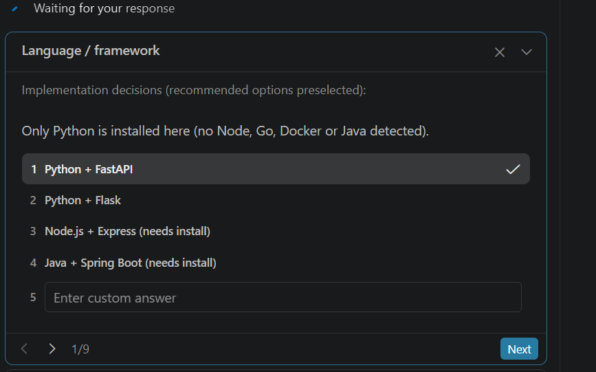
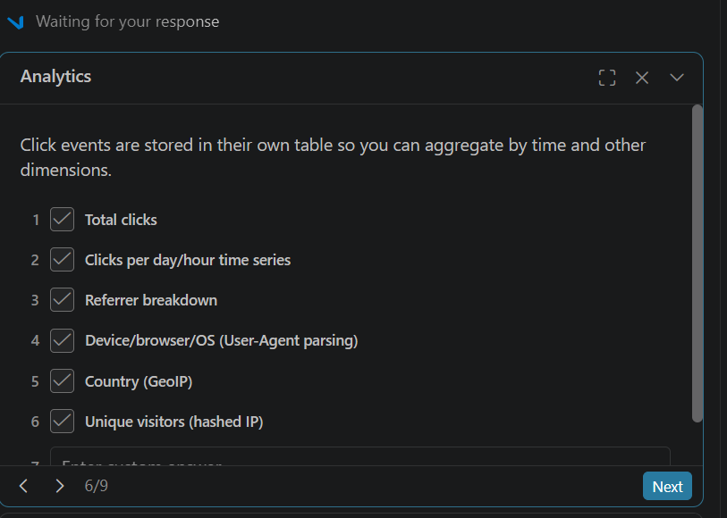
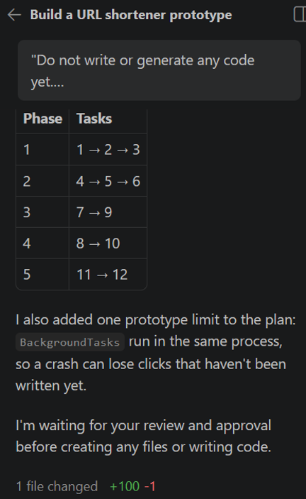
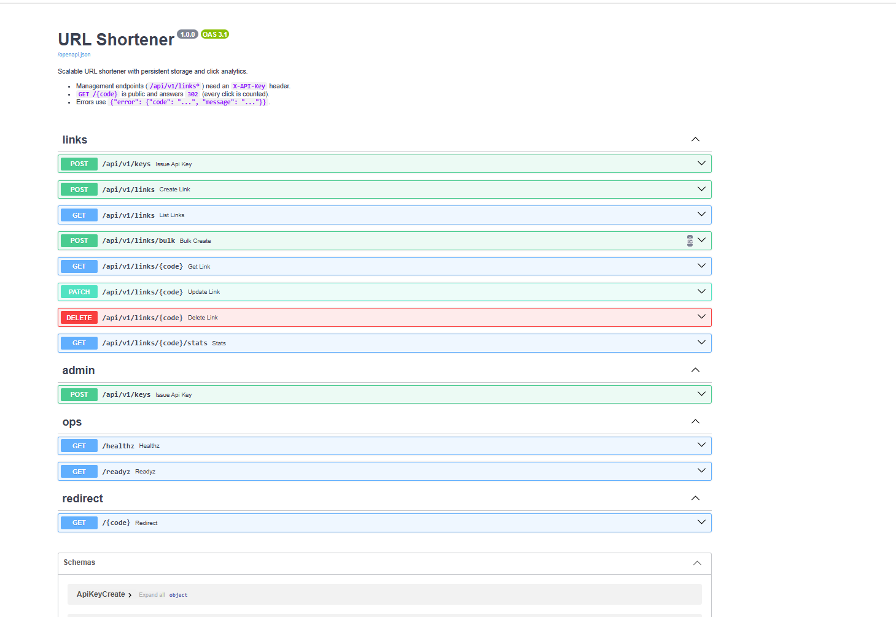

# AI Interaction & Engineering Governance Log

**Project:** FastAPI URL Shortener (APIs, persistent storage, click analytics)
**Lead Engineer:** Human-in-the-loop engineer
**AI Collaborator:** GitHub Copilot agent (Claude Sonnet 5.5, High reasoning, 1M context, interactive mode, manual permissions)
**Governance Model:** Clarify first, plan before code, engineer approves every decision

This log records how AI was used on this project and where the engineer made the decisions. The screenshots under [Screenshots/](Screenshots/) are the evidence. Technical detail lives in [ARCHITECTURE.md](ARCHITECTURE.md) and [ENGINEERING_SUMMARY.md](ENGINEERING_SUMMARY.md).

---

## 1. Executive Summary & Governance Model

AI was used as an execution accelerator while the engineer retained control of every design decision.

1. **Clarify before building.** The first prompt explicitly told the AI to ask for input before deciding on the API, code generation, database and other implementation details. The AI responded with a 9-question interactive form (`n/9` in the screenshots).
2. **Plan before code.** The AI produced a task plan (`PLAN.md`) and was told not to write code until the engineer reviewed it.
3. **Engineer overrides.** The engineer reviewed the plan and issued architectural adjustments (code generator, analytics ingestion, API contract). See section 3.
4. **Phased delivery.** The plan was grouped into 5 phases with explicit task dependencies.
5. **Verified output.** Every claim in the docs is backed by an executed command: 87 automated tests, 94% line coverage, a live `uvicorn` walkthrough and a load check (see [ENGINEERING_SUMMARY.md](ENGINEERING_SUMMARY.md)).

---

## 2. Phase 0: Clarification & Interactive Scoping

### Initial Prompt

```text
I want to build a URL shortener prototype with APIs, persistent storage, and click analytics. Functional requirements include: 1) Users should be able to submit a long URL and receive a unique short URL. Cover every requirement, and ask for my input before deciding the API, code generation, database, and other implementation details.
```

Before asking questions, the AI checked what tooling was available on the machine:

```text
python --version; node --version; go version; docker --version; java -version 2>&1 | Select-Object -First 1
```

The terminal confirmation was reviewed and allowed. Result: only Python was installed (no Node, Go, Docker or Java), which is why Node/Java options were marked "needs install".


### Interactive Scoping: Options Presented vs Engineer Decisions

| # | Category | Options Presented | Engineer Decision | Rationale (from the question text and design docs) | Evidence |
| :-- | :--- | :--- | :--- | :--- | :--- |
| 1/9 | **Language / framework** | Python + FastAPI, Python + Flask, Node.js + Express (needs install), Java + Spring Boot (needs install) | **Python + FastAPI** | Only Python is installed; FastAPI gives async-capable APIs and an auto-generated OpenAPI schema. |  |
| 3/9 | **Short-code generation** | Auto-increment ID encoded in Base62 (+ salt/obfuscation); random 7-char Base62 with collision retry; truncated SHA-256 hash | **Auto-increment ID encoded in Base62 (+ salt/obfuscation)** | Counter + Base62 gives no collisions and short codes; random needs collision retries; hash is deterministic. |  |
| 4/9 | **API features** | Custom aliases, expiration (TTL), link deletion/disable, bulk create, API key auth, rate limiting, idempotent create (same URL returns same code) | **All selected** (core create / redirect / stats endpoints always included) | Covers every functional requirement plus abuse protection. |  |
| 5/9 | **Redirect type** | 302 (temporary, every click counted); 301 (permanent, cached by browsers) | **302** | Browsers do not cache 302, so every click reaches the service and is counted; links can be disabled or expired. |  |
| 6/9 | **Analytics** | Total clicks; clicks per day/hour; referrer breakdown; device/browser/OS (User-Agent parsing); country (GeoIP); unique visitors (hashed IP) | **All selected** | Click events live in their own table so they can be aggregated by time and other dimensions. |  |
| 7/9 | **Scalability measures** | Async click recording; in-memory LRU cache (Redis-ready interface); stateless app + Docker files; Locust load test | **Async click recording + LRU cache** (Docker and Locust not selected) | Redis needs a server; the in-process cache works with none. Load checking was done with a stdlib script (`scripts/bench.py`) instead of Locust. |  |
| 8/9 | **Requirement-analysis prototype** | CLI that emits a task breakdown, risks, assumptions and ambiguities as JSON/Markdown (rule-based, no LLM key); same CLI optionally calling an LLM API; docs only | **Rule-based CLI, no external LLM key** | The assignment requires the prototype to accept a requirement and produce structured output; rule-based output is deterministic and needs no credentials. |  |

The datastore decision (SQLite via SQLAlchemy, switchable to PostgreSQL through `DATABASE_URL`) is recorded in [ENGINEERING_SUMMARY.md](ENGINEERING_SUMMARY.md).

---

## 3. Planning Gate & Engineer Interventions

### Plan generation

The AI was asked to put the task breakdown into a document:

```text
please create a document with this tasks.
```

The AI produced `PLAN.md`: a 12-task table (project setup, data model, auth, code generator, create endpoint, redirect endpoint, management endpoints, analytics, and so on), each mapped to the requirements it covers, plus the known SQLite-only limits. It stated that no code had been written yet and waited for approval.


### Engineer review of the plan

The engineer reviewed `PLAN.md` and approved it with architectural adjustments, shown in the screenshot above:

1. **Code generator (Task 4):** do not use a salted shuffle of the auto-increment ID; use 7-character alphanumeric tokens generated with `secrets.choice`, with collision retry (max 3 attempts).
2. **Analytics (Task 8):** do not batch in memory without safeguards.
3. **API contract:** version the API under `/api/v1/`.

The engineer then instructed the AI not to write or generate any code, to update the plan, and to wait for approval:

```text
"Do not write or generate any code yet....
```

The AI updated the plan (+100 lines), grouped the tasks into five phases, and added one prototype limit of its own: `BackgroundTasks` run in the same process, so a crash can lose clicks that have not been written yet. It stopped and waited for approval before creating any files.

| Phase | Tasks |
| :--- | :--- |
| 1 | 1 → 2 → 3 |
| 2 | 4 → 5 → 6 |
| 3 | 7 → 9 |
| 4 | 8 → 10 |
| 5 | 11 → 12 |



### Plan vs. as-built

The plan was a starting point; the shipped design follows the decisions in [ARCHITECTURE.md](ARCHITECTURE.md). Where they differ, the as-built column is authoritative.

| Topic | In the reviewed plan | As built |
| :--- | :--- | :--- |
| Project layout | `pyproject.toml`, Alembic, Dockerfile | Flat `app/` package, `requirements*.txt`, tables created at startup (no migrations, no Docker; listed as known limitations) |
| Short codes | Random 7-char tokens, 3-attempt retry (engineer adjustment) | Keyed Feistel permutation of the auto-increment ID, Base62, fixed 7 characters: collision-free by construction, not enumerable (matches the option chosen at question 3/9) |
| API paths | `/api/users`, `/api/urls`, `/api/urls/{code}/stats` | `/api/v1/keys`, `/api/v1/links`, `/api/v1/links/{code}/stats` |
| Click recording | FastAPI `BackgroundTasks` | Bounded in-memory queue + one writer thread; batched transactions (500/txn); drain on shutdown; drop counter on `/readyz` |
| Auth | `X-API-Key` | `X-API-Key`; keys are 256-bit and stored hashed |

### Result: the running API

The generated OpenAPI/Swagger UI confirms the delivered contract: link CRUD and bulk create, admin key issuing, ops probes and the public redirect.



| Group | Endpoints |
| :--- | :--- |
| links | `POST /api/v1/links`, `GET /api/v1/links`, `POST /api/v1/links/bulk`, `GET`/`PATCH`/`DELETE /api/v1/links/{code}`, `GET /api/v1/links/{code}/stats` |
| admin | `POST /api/v1/keys` |
| ops | `GET /healthz`, `GET /readyz` |
| redirect | `GET /{code}` (302) |

---

## 4. Verification Evidence

| Check | Result |
| :--- | :--- |
| Automated tests | **87 passed** (`python -m pytest`) |
| Line coverage | **94%** (`--cov=app --cov=analyst`) |
| Live walkthrough | Real `uvicorn`; created a key and a link over HTTP; redirected with a mobile User-Agent and referrer; stats showed referrer host `news.ycombinator.com`, OS `iOS`, device `Mobile` |
| Load check (`scripts/bench.py`) | ~600 redirects/s, p50 ≈ 21 ms, p95 ≈ 62 ms, 0 errors, 4,764/4,764 clicks recorded (proves correctness under concurrency, not capacity) |
| CI | GitHub Actions: ruff (syntax/undefined names) + `pytest -v` on Python 3.11 and 3.12 |

### Defects found during validation and fixed

1. A draft placeholder short code derived from the URL hash could collide for concurrent first-time creates by different owners, so it was replaced with a random placeholder (caught in code review).
2. OpenAPI "Duplicate Operation ID" warning from registering GET and HEAD together, so they were split into two routes (HEAD is not counted as a click).
3. Analyser false positive: the word "traffic" in "bot traffic" triggered the scalability rule. The keyword was narrowed to "high traffic", found by a failing test.
4. The benchmark script crashed on an idled-out keep-alive connection, so it now uses a fresh connection.
5. Port 8000 was occupied on the dev machine, so the README documents `--port` / `BASE_URL`.

Known limitations (SQLite single writer, PostgreSQL untested, per-process cache and rate limiter, no migrations, no key revocation endpoint) are listed in full in [ENGINEERING_SUMMARY.md](ENGINEERING_SUMMARY.md).

---

## 5. AI Contribution vs Engineer Ownership

| Task | AI assisted with | Engineer decision / ownership |
| :--- | :--- | :--- |
| Requirement understanding | Extracted requirements, proposed the 9 design questions | Chose framework, code generation, API features, redirect type, analytics, scalability measures, prototype style |
| Planning | Drafted `PLAN.md` and phase grouping | Reviewed the plan, issued adjustments, required approval before any code |
| Implementation | Generated modules, schemas, routes | Reviewed output; corrected defects found during validation |
| Tests | Drafted unit and integration tests | Defined behaviours to assert (boundaries, tenant isolation, failure paths) |
| Debugging | Diagnosed warnings and a classifier false positive | Verified fixes by re-running tests |
| Documentation | Drafted README and docs | Commands were executed to verify them |

---

## 6. Reviewer Verification Guide

```powershell
# 1. Set up
python -m venv .venv
.\.venv\Scripts\python -m pip install -r requirements-dev.txt

# 2. Run the automated test suite (87 tests)
.\.venv\Scripts\python -m pytest

# 3. Start the service and open the API docs at http://127.0.0.1:8000/docs
.\.venv\Scripts\python -m uvicorn app.main:app_factory --factory --port 8000

# 4. Load check against the running service
.\.venv\Scripts\python scripts/bench.py --base http://127.0.0.1:8000 --key <api key>

# 5. Requirement-analysis CLI and the standalone proposal generator
.\.venv\Scripts\python -m analyst "Build a scalable URL shortener service with APIs, persistence, and analytics."
.\.venv\Scripts\python scripts/requirement_to_output.py "Build a URL shortener with APIs and analytics"
```
